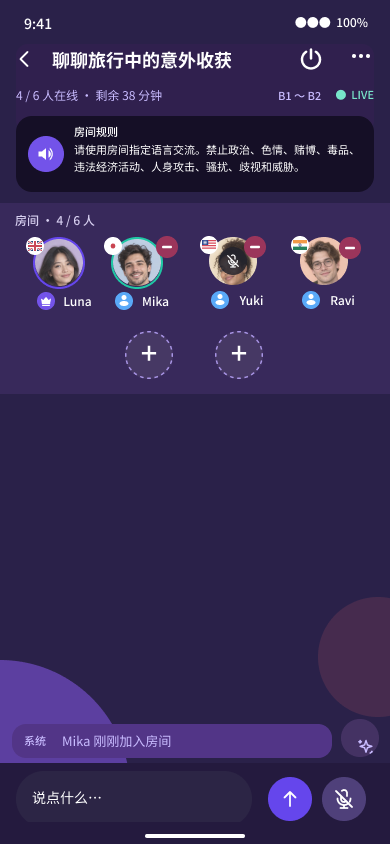
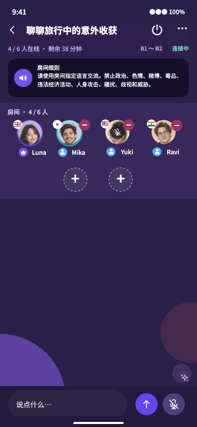

# Room admission, exit and official LiveKit audit evidence

Recorded 2026-10-13 (Asia/Shanghai) for `optimize-room-entry-and-immediate-exit` in PR #22. See [the official-source comparison and flow diagrams](../../architecture/livekit-room-lifecycle.md).

## Implemented boundaries

- A normal session admits through POST memberships without a preliminary GET detail; a fresh creation response is reusable only by its authenticated creator for ten seconds. Credential authorization remains server-authoritative.
- Admitted room layout remains visible during token/media preparation. Member display data is requested alongside credentials. Microphone controls remain disabled until connection, and entry still automatically checks devices without publishing the probe.
- Local leave/end stops tracks/output and navigates to discovery without awaiting backend or media cleanup, a confirmation-only handoff page, or a terminal result page. The existing designated-successor API remains validated; normal exit uses the first eligible connected member in joining order.
- Native SecureStore/browser noncredential localStorage retain actor-bound exit intent outside the room screen. Request failures survive same-account restart; old-account authorization callbacks cannot use the new account's token. Pending exit rooms are filtered from local reentry and failures remain retryable on discovery.
- Host end returns a durable database result before LiveKit cleanup. Vercel tracks post-response queue scheduling; worker/recovery performs provider cleanup. An uncommitted provider failure is not presented as a room-state rollback.
- Provider CreateRoom get-or-create replaces list-then-create. Capacity, provider SID, member generation and issuance lease checks remain. A changed room time/version rejects the old reservation and queues metadata correction.
- SDK terminal room deletion/member removal returns to discovery; SDK transport recovery remains separate. prepareConnection overlaps local audio setup on the same Room and is never awaited as an extra admission gate.

## Executed evidence

- Mobile: 55 suites, 200 tests. Covers pending admission cancellation, creator/account/cache binding, nonblocking exit, secure persistence before delivery, retry/restart, late account authorization, native UTF-8, permissions, retained tabs and room interactions.
- API: 44 unit suites / 242 tests, 41 integration suites / 211 tests, 20 HTTP suites / 107 tests. Includes admission revocation/room-SID/issuance barriers, old-generation rejection, default/designated succession, committed end with failed provider, scoped reports and durable recovery. A delayed queue send proves HTTP completion precedes post-response command scheduling completion.
- Browser: all 34 visual-harness checks, including the admitted connecting surface, disabled microphone, immediate host end, room reports, navigation tint, compact creation, unchanged four-column seat geometry, invitation and direct chat.
- Admin: 3 tests. Prior room-case browser and nullable historical migration evidence remain in `../room-reporting-and-discovery/README.md`.
- Workspace formatting, lint, dependency boundaries, types, generated sole OpenAPI/client consistency and Android Expo bundle export pass. A final layout-effect adjustment reran the 12 actual screen tests and connecting/end browser scenario; it avoids a transient initial/terminal paint before navigation.

The tests caught stale fixture assumptions about mandatory handoff, auth context and the initial connection page. Fixtures were updated to the approved one-action/visible-room behavior; server authorization assertions were preserved. Existing QueueClient local-region diagnostics and React Native Web deprecation warnings remain nonfatal. No application credentials appear in these records.

## Original-to-runtime comparison

The Desktop Bridge confirmed the untouched original `115:1425`, `02 UI / Voice Room / Pilot V2 · review`, 390×844 in file `56nIowZmvBhb0QJvOlDQdU`. The original was exported directly through the Bridge, not reconstructed. The runtime uses the actual VoiceRoomScreen with explicit provider/session fixture adapters at 390×844.

| Original | Admitted while connecting |
| --- | --- |
|  |  |

The room header, rule banner, seats, background and composer geometry remain. The connecting label replaces LIVE until the SDK connects. An empty message fixture explains the missing source system-message row; this is not a historical-message removal. Removal of mandatory exit handoff/result pages is the owner's authorized interaction override. Web fixtures establish layout and event wiring, not native typography, OS permissions or live audio fidelity.

## Timing and release limits

UI admission/visibility, credential completion, SDK connection, playback prerequisites, first remote track subscription and explicit microphone publication have distinct monotonic markers. No physical-device speedup or audible-speech latency has been measured for this source revision. Output availability/track attachment is not equivalent to hearing speech; publication is not proof the peer heard it. Two-device microphone, output route, foreground/background, network recovery and perceived navigation remain owner-operated acceptance.

This evidence is prepublication. Main/API/Pages alignment, the existing backup/restore and nullable-target migration gates, actual signed APK manifest/hash/source verification and production smoke are required before presenting a new APK as released. OpenSpec changes remain active until their applicable acceptance/release tasks are complete.
