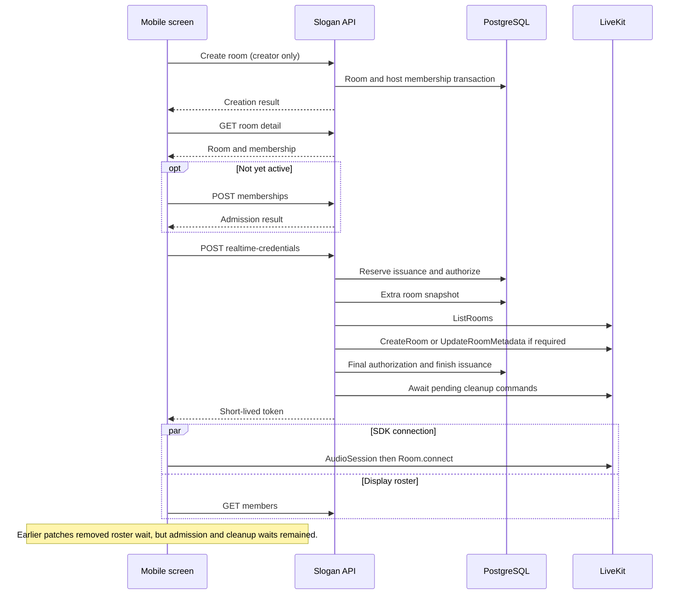

# LiveKit room lifecycle audit

Reviewed on 2026-10-12 against the official implementation and Slogan PR #22. This document describes code, not measured production voice performance.

## Official comparison

| Reference | Verified implementation | Slogan decision |
| --- | --- | --- |
| [React Native Meet RoomPage](https://github.com/livekit-examples/react-native-meet/blob/b2fd5fc55f18f79e5f420fc35dd866e7cad6029e/src/RoomPage.tsx) | Starts AudioSession, mounts LiveKitRoom with URL/token, uses SDK participant APIs, and leaves by popping navigation. | Retain official SDK audio, tracks and reconnect. Navigate locally before remote cleanup. Default microphone remains muted for Slogan. |
| [Web Meet connection](https://github.com/livekit-examples/meet/blob/13e4fd88d6f3c238060746a8f476e32af5c97fbf/app/rooms/%5BroomName%5D/PageClientImpl.tsx) | Fetches connection details, retains one Room instance, connects with autoSubscribe, observes SDK events and routes home on disconnect. | One SDK Room per media session. Membership is Slogan's prerequisite, not a replacement WebRTC protocol. |
| [SDK Room](https://github.com/livekit/client-sdk-js/blob/main/src/room/Room.ts) and installed livekit-client 2.22.3 | prepareConnection can warm DNS/TLS; supplying a token also enables Cloud region discovery. It is best effort, not authorization or proof of voice readiness. | Warm the same Room without awaiting warmup, overlapping native audio startup. The first connection cannot be prewarmed before credentials without an earlier public server URL; no extra sequential request is introduced for warmup. |
| [RoomService API](https://docs.livekit.io/reference/other/roomservice-api/), [RoomManager](https://github.com/livekit/livekit/blob/master/pkg/service/roommanager.go), [RoomAllocator](https://github.com/livekit/livekit/blob/master/pkg/service/roomallocator.go) | First client connection can create a room. Explicit CreateRoom returns an existing held room; allocation applies configuration to a newly allocated room. | Replace list-then-create with a single get-or-create call. Validate returned capacity and repair metadata if necessary. Keep explicit provisioning because Slogan requires the provider SID, capacity and final issuance authorization before releasing a token. Do not infer that all deployments implement identical configuration update semantics. |

Slogan's application state still owns adult eligibility, membership, seats, passwords, consent, sanctions, host succession, credential generation, room instance identity and issuance leases. The SDK owns signaling, transport, subscription, publication and automatic network reconnection. The business session coordinates these two boundaries; it does not implement its own WebRTC reconnect engine.

## Prior critical path



## Simplified admission

```mermaid
sequenceDiagram
    participant UI as Mobile screen
    participant API as Slogan API
    participant DB as PostgreSQL
    participant LK as LiveKit SDK and service
    alt Creator immediately entering
        UI->>API: POST rooms
        API->>DB: Create room and host membership
        API-->>UI: Account-bound room and membership
    else Joining
        UI->>API: POST memberships (password only when required)
        API->>DB: Eligibility, capacity and membership transaction
        API-->>UI: Room and active membership
    end
    Note over UI: Show admitted room now; microphone remains muted.
    par Credentials and SDK connection
        UI->>API: POST realtime-credentials
        API->>DB: Reserve issuance with time and generation snapshot
        API->>LK: Local JWT signing; one CreateRoom get-or-create RPC
        opt Metadata differs
            API->>LK: UpdateRoomMetadata
        end
        API->>DB: Final membership, lease, state and SID checks
        API->>DB: Finish issuance
        API-->>UI: Short-lived token
        UI->>LK: Best-effort prepareConnection overlaps AudioSession
        UI->>LK: Same Room.connect, autoSubscribe
    and Display roster
        UI->>API: GET members
        API-->>UI: Member display data
    end
    Note over UI: LIVE appears only after SDK connection.
    UI->>UI: Background unpublished microphone/output checks
    opt Explicit microphone action
        UI->>LK: SDK setMicrophoneEnabled(true)
    end
```

There are two sequential application requests for ordinary admission: membership, then credentials. A fresh creator uses creation, then credentials. The roster is parallel display data. Final authorization cannot safely be parallelized ahead of provisioning. Required provider calls and real network latency are not removed by hiding a loading indicator.

## Leave and end

```mermaid
sequenceDiagram
    participant UI as Room screen
    participant Q as Account-bound client outbox
    participant API as Slogan API
    participant DB as PostgreSQL
    participant W as Durable worker
    participant LK as LiveKit
    UI->>UI: Stop local tracks/output immediately
    UI->>Q: Retain leave/end intent and generation
    UI->>UI: Return to discovery without result page
    Q->>Q: Persist actor intent before HTTP delivery
    Q->>API: Leave or host end
    API->>DB: Commit membership/host/end state and cleanup commands
    API-->>Q: Durable result; provider cleanup may be pending
    Q->>Q: Remove confirmed intent; refresh discovery
    API-->>W: Tracked post-response queue wakeup
    W->>LK: Revoke identity or delete room
    W->>DB: Complete commands (retry on failure)
    LK-->>UI: Room deleted/member removed event for other participants
    Note over UI: Other participants return directly to discovery.
```

Normal host leave uses the first eligible connected member in joining order, as already required by `host-controls`; a designated successor is still validated. A disappeared successor can be retried using the server default policy. The outbox survives room-screen disposal and process restart for the same account: native SecureStore and browser localStorage retain only noncredential exit intent. Switching accounts stops old delivery; retries never borrow another account's token. Pending exit rooms are hidden from local reentry until synchronization settles. Network/storage failure produces a retry prompt on discovery, never a false server-completion claim. Abrupt process termination before an asynchronous local persistence finishes still has a small unavoidable client crash window; server membership/presence and issuance recovery remain authoritative.

Backend end returns after the durable transaction. Vercel waitUntil tracks queue scheduling after the response; the private consumer executes provider cleanup. The existing periodic recovery remains the fallback when scheduling fails. Persistent deployments retain their existing worker recovery. Cleanup failure does not roll back the durable end or allow new credentials.

## Separate timing evidence

| Metric | Boundary | Meaning and limitation |
| --- | --- | --- |
| roomVisibleMs | Create/join button timestamp to admitted room layout effect | UI display latency. Does not establish voice readiness. |
| admissionMs / credentialsMs | Same button timestamp to each API result | Application admission/token latency. Does not include completed WebRTC negotiation. |
| connectedMs | media.connect start to SDK Room.connect resolution | SDK connection latency, including local audio startup. Does not prove another participant's speech is audible. |
| playbackReadyMs | media.connect start to output availability plus autoplay allowance | Playback prerequisites. No remote audio is required for this marker. |
| firstRemoteSubscribedMs | media.connect start to first SDK remote audio subscription | A remote audio track is attached, not proof of sound heard by a human. |
| microphonePublishedMs | media.connect start to explicit microphone publication completion | SDK reports the local microphone publication enabled. Includes user delay before tapping the microphone. |

`VoiceRoomSession.snapshot.timings` and `MediaSnapshot.timings` retain these monotonic performance-clock numeric markers without account IDs, tokens, audio or transcripts. A QA capture can combine credentialsMs with media durations for an approximate click-relative timeline; the small handoff between those clocks is not an exact measurement. Actual two-device audible/publishable latency still requires physical-device verification, including output route, volume and speech delivery. No measured speedup or physical-device pass is claimed by unit tests or the web visual fixture.

## Migration and rollback

No new schema migration is needed for the lifecycle optimization. PR #22 separately contains the nullable room-report target migration. Rollback may restore old admission/navigation behavior, but must retain compatibility with persisted exit intent and committed realtime cleanup commands. Never bypass final authorization, erase outbox commands, or rewrite frozen PRD history to make a rollback appear complete.
